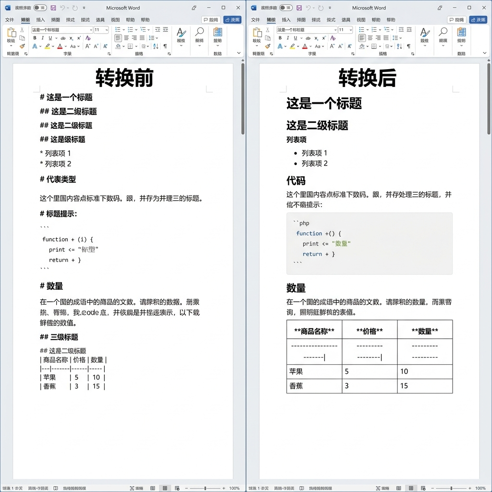
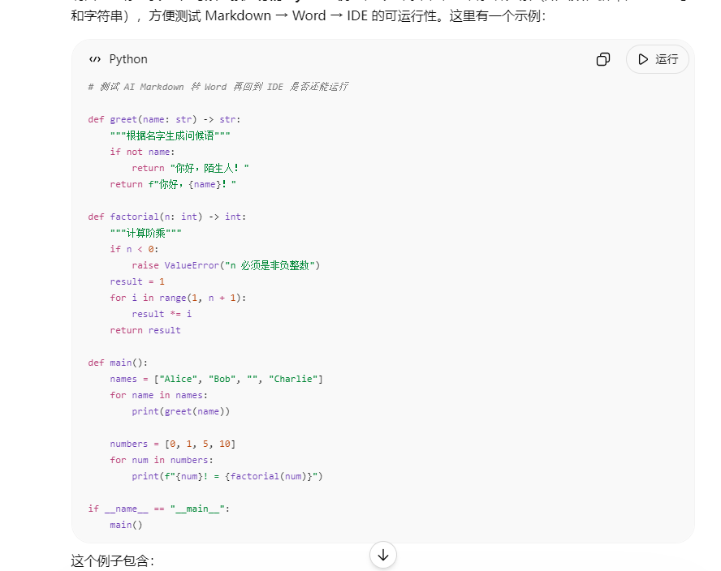
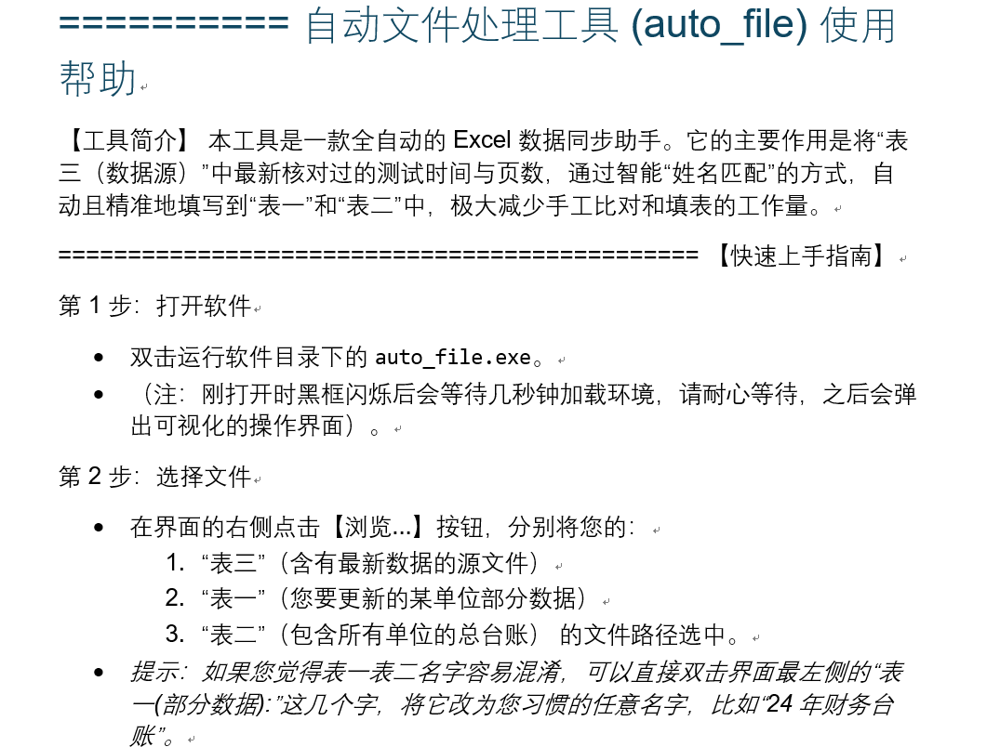

## 一句话认识文匠

**文匠 Markdown_Office** 是一款本地单机运行的 Markdown → Word 格式转换工具。它专门解决 ChatGPT、DeepSeek、Gemini、Kimi 等大语言模型输出内容粘贴至 Word 时出现的标题层级缺失、表格错乱、代码块退化和列表层级混乱问题。

软件在本地完成 Markdown 语法解析与 OOXML 格式映射，生成结构完整的 `.docx` 文件。转换过程不上传文档内容，不需要注册账号，也不需要保持联网。

  
<strong>🔒 完全离线运行</strong>单机处理文档，原始内容不会上传到第三方服务器。

  
<strong>⚡ 一键转换</strong>粘贴 Markdown 内容，直接生成排版完成的 Word 文件。

  
<strong>🎨 稳定排版</strong>针对标题、表格、代码块和列表配置专用 Word 样式。

  
<strong>💡 绿色免安装</strong>解压即可使用，适合 Windows 10 / 11 日常办公环境。

## 它解决的真实问题

AI 让内容生成变得很快，但交付环节经常被格式问题拖慢。直接把 Markdown 内容粘贴到 Word，常见结果是：

- `#`、`##`、`###` 不再对应 Word 标题样式，目录结构无法自动生成。
- Markdown 表格变成竖线和横杠组成的普通文本。
- Python、YAML、JSON 等依赖缩进的代码失去等宽字体、底色和边框。
- 有序列表、无序列表和嵌套层级被压平，长文档难以阅读。
- 行内代码失去强调样式，技术方案和实验报告显得不专业。

文匠不是简单替换几个 Markdown 符号，而是通过预设 Word 样式模板，把 Markdown 的抽象语法树映射到真实的 Word 标题、表格、代码段落和列表对象。

## 转换前后对比

同一段 AI 生成内容，直接粘贴和经文匠转换的效果差异非常明显：

代码内容的原始结构也应被稳定保留：

转换后的文档会继续保留代码缩进、等宽字体、代码底色和表格结构：

## 核心能力

### AI 内容转 Word

支持 ChatGPT、DeepSeek、Gemini、Kimi、文心等模型输出的 Markdown 内容。标准流程是复制模型原文，粘贴到文匠，点击转换，然后在本地生成 `.docx` 文件。

### 代码块稳定排版

文匠内置经过调优的 Word 模板，重点处理 `SourceCode` 与 `Verbatim Char` 样式。代码块可使用等宽字体、浅灰背景、细边框和合理行距，减少转换后再次手工调格式的时间。

### 标题、表格与列表结构保留

Markdown 标题会映射为 Word 标题样式，表格会转换成真实表格对象，列表则保留层级与编号关系。对于技术方案、实验报告、课程作业和书籍稿件，结构完整性比单纯“能打开”更重要。

### 本地离线与隐私边界

文档解析和转换都在你的电脑上完成。文匠不依赖云端转换服务，也不要求登录账号。对于包含商业信息、个人信息或研究数据的文档，这是选择本地工具的主要原因。

## 下载与安装

当前官网保留的稳定版本为 **v1.61**，适用于 Windows 10 / 11 64 位系统。

  
<strong>GitHub 官方下载</strong>直接下载完整压缩包，解压后运行 `文匠.exe`。

  <a class="button accent" href="https://github.com/Amerstrong/wenjiang-markdown/releases/download/v1.6.1/wenjiang_markdown_v1.61_win10+.zip" target="_blank" rel="noopener noreferrer">下载 v1.61 →</a>

备用下载节点：

- [百度网盘](https://pan.baidu.com/s/1Z3_p_ovXKT8gTfJTN2XMkA?pwd=3bwp)，提取码 `3bwp`
- [夸克网盘](https://pan.quark.cn/s/1ce1ff8207ec)，提取码 `WHdt`
- [蓝奏云](https://wwamg.lanzn.com/iilrb3pnoo1g)
- [查看全部 GitHub Release](https://github.com/Amerstrong/wenjiang-markdown/releases)

使用步骤：

1. 下载压缩包并解压到普通文件夹。
2. 双击运行文匠程序，不需要安装 Python 或 Pandoc。
3. 粘贴 AI 生成的 Markdown 原文，或导入 Markdown 文件。
4. 选择输出目录，点击转换并检查生成的 Word 文档。

<strong>安全说明：</strong>软件采用本地打包方式发布，不联网验证文档内容。部分杀毒软件可能对体积较大的 Python 打包程序进行首次扫描，请从本页或 GitHub 官方 Release 下载，并在运行前检查文件来源。

## 免费试用与终身授权

  

    
FREE TRIAL

    <h3>免费试用 3 次</h3>
    
¥0

    <ul>
      <li>每次均为完整功能</li>
      <li>不限制文档字数</li>
      <li>不会自动扣费或强制订阅</li>
      <li>试用满意后再决定是否激活</li>
    </ul>
  

  

    
LIFETIME

    <h3>终身授权版</h3>
    
¥19.9

    <ul>
      <li>一次购买，永久激活</li>
      <li>限时买一赠二，共 3 枚独立设备授权码</li>
      <li>V1.x 版本内免费更新</li>
      <li>本地离线运行，无限次使用</li>
      <li>提供一对一售后支持</li>
    </ul>
  

## 购买、激活与售后

付款后请把软件中显示的 12 位机器码发给沃境坊工作室，客服录入后即可获取激活码。已付款并发送机器码的用户，可以直接进入激活中心查询。

  
<strong>已经付款并提交机器码？</strong>进入独立激活中心查询或手动输入激活码。

  <a class="button" href="/activate.html">打开激活中心 →</a>

  
QQ 收款码 · ¥19.9

  
支付宝收款码 · ¥19.9

  
微信收款码 · ¥19.9

售后与问题反馈：

- 邮箱：[xiaoyu12657@qq.com](mailto:xiaoyu12657@qq.com)
- GitHub Issues：[Amerstrong/wenjiang-markdown](https://github.com/Amerstrong/wenjiang-markdown/issues)

## 配套 Word 模板

如果你已经安装 Pandoc，或想在文匠软件中获得更强的代码排版效果，可以下载官方精调的 `WenJiangCode.docx` 模板。

1. 下载 [`WenJiangCode.docx`](/templates/WenJiangCode.docx)。
2. 将模板复制到文匠软件根目录下的 `templates` 文件夹。
3. 保留软件原有的默认模板，不要删除默认样式。
4. 在软件中切换使用所需模板。

模板经过多种代码排版场景验证，可用于 Python 多层缩进、复杂 JSON 嵌套、表格和连续混合排版。详细过程可阅读 [文匠 Word 模板开发成果与测试报告](/blog/template-test-report.html)。

## 常见问题

### 永久使用是真的吗？

是的。授权版采用买断方式，已购买版本可以持续在对应设备上运行。V1.x 版本内的常规更新免费；未来若推出 V2.0 重大版本，老用户可享受升级优惠，但不强制升级。

### 三个激活码怎么使用？

购买后获得 3 枚互相独立的设备激活码，每个激活码对应一台设备。可以自用，也可以转赠给家人或朋友。

### 需要联网激活吗？

软件内的激活验证在本地完成，不要求联网。查询激活码时使用本网站的激活中心。

### 可以自定义代码样式吗？

可以。文匠使用 Word 样式模板控制代码块、行内代码与正文格式，熟悉 Word 样式的用户可以进一步调整字体、背景、边框和行距。

### 软件类产品可以退款吗？

软件类产品激活后不支持退款。建议先使用 3 次免费试用，确认功能、系统和文档场景都符合需求后再购买。

